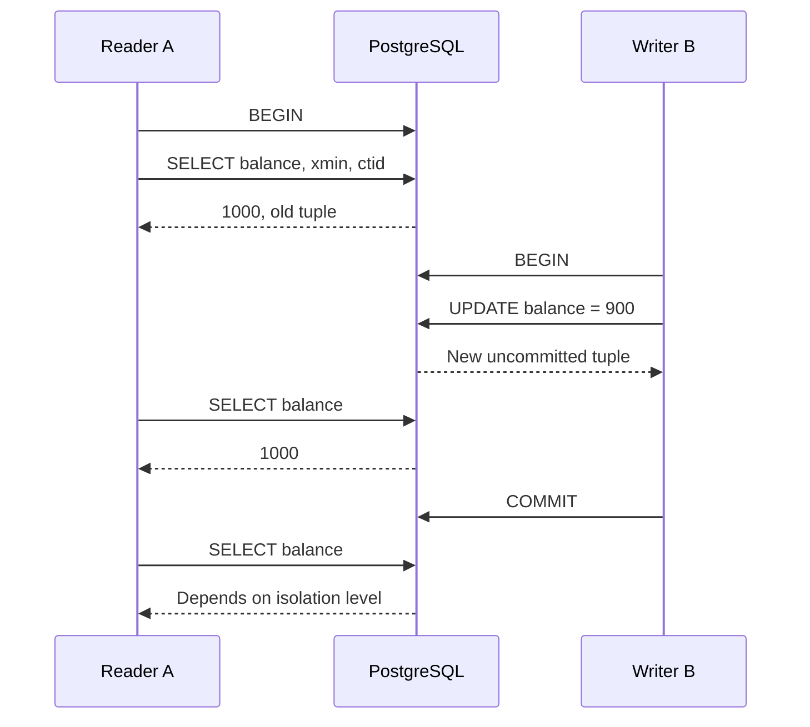
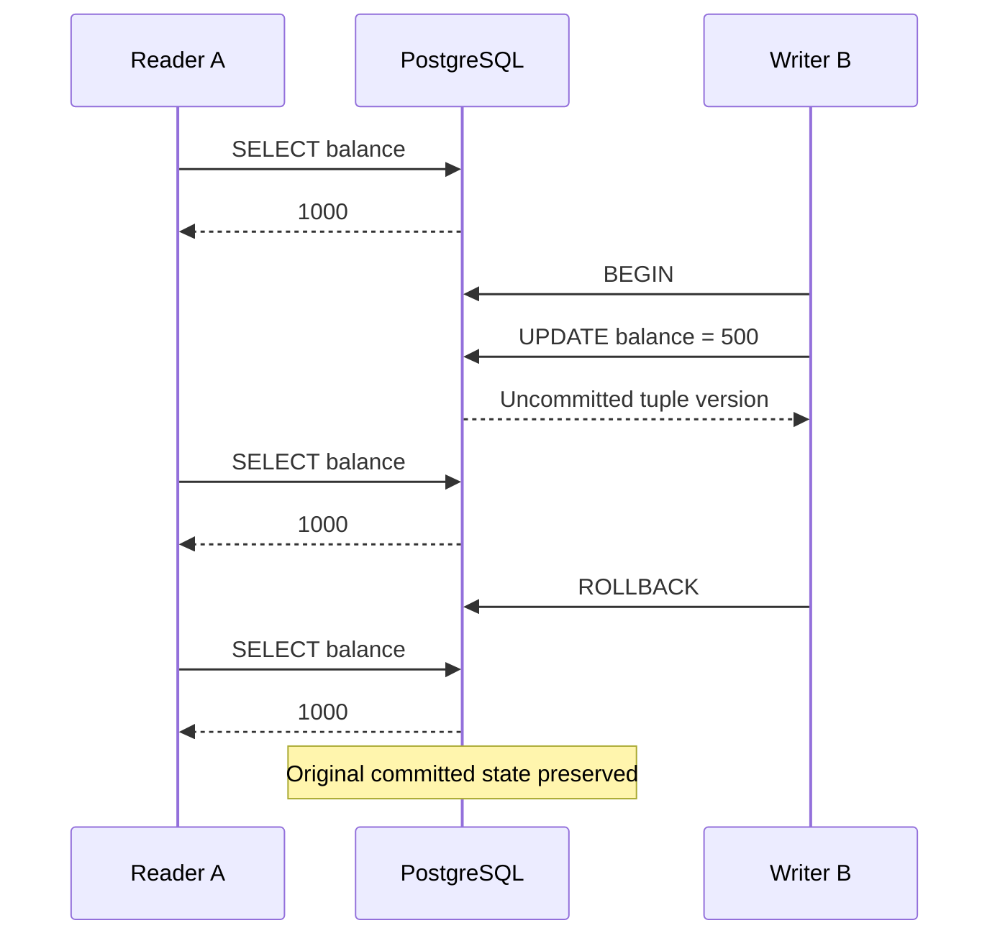

# 06 — PostgreSQL MVCC Internals

**Understanding Multi-Version Concurrency Control, tuple visibility, transaction snapshots, rollback, HOT updates, and VACUUM using Go and PostgreSQL.**

PostgreSQL allows multiple transactions to read and modify the same logical records concurrently while maintaining transactional consistency.

One of the mechanisms enabling this behavior is **Multi-Version Concurrency Control (MVCC)**.

Instead of modifying a row in place, PostgreSQL generally creates a new tuple version when an existing row is updated. Different transactions may observe different versions of the same logical row depending on their snapshots.

This example investigates how that works internally using PostgreSQL system columns and reproducible integration tests.

> **Core principle:** A database row's current logical state and the physical tuple version visible to a transaction are not necessarily the same thing.

---

## 1. What Is MVCC?

Multi-Version Concurrency Control is a concurrency-control technique that maintains multiple versions of data so transactions can read consistent snapshots without necessarily blocking concurrent writers.

Consider a wallet with balance 1000.

Transaction A reads the wallet.

Transaction B modifies the balance to 900.

Instead of overwriting the existing tuple in place, PostgreSQL creates a new row version.

```text
                    Logical Wallet
                   ID = wallet-123
                         |
             +-----------+-----------+
             |                       |
             v                       v
        Old Tuple                New Tuple
      balance = 1000           balance = 900
       xmin = T1               xmin = T2
       xmax = T2               xmax = 0*
             |                       |
             +-----------+-----------+
                         |
                  MVCC visibility
                         |
                  Which version
                can this transaction
                       see?
```

`*` The metadata values are illustrative. A tuple's visible `xmax` is not guaranteed to be zero.

The version visible to a transaction depends on factors including:

- Whether the version's creating transaction committed.
- Whether a modifying or deleting transaction committed.
- The transaction's snapshot.
- PostgreSQL's tuple visibility rules.

Multiple physical tuple versions can therefore represent one logical row over time.

## 2. Why MVCC Matters

Without suitable concurrency control, long-running readers and frequent writers could interfere with one another significantly.

PostgreSQL MVCC provides several useful properties:

**Read consistency**

Transactions see rows according to their snapshot rather than simply observing uncommitted changes.

**Reduced read/write blocking**

An ordinary `SELECT` generally does not block a concurrent row update, and a row update does not ordinarily block a plain MVCC read.

**Transaction isolation**

Different isolation levels define how long a snapshot remains relevant.

**Rollback support**

An aborted transaction's newly created row versions do not become committed database state.

**Concurrent access**

Applications can read and update shared tables while PostgreSQL coordinates visibility and conflicting writes.

MVCC does not eliminate all locking. Writes still acquire locks, and explicit locking queries such as `SELECT FOR UPDATE` can block.

## 3. Tech Stack

| Component | Technology |
|---|---|
| Language | Go |
| Database | PostgreSQL 16 |
| Driver | pgx/v5 |
| Connection pooling | pgxpool |
| Containerization | Docker Compose |
| Integration tests | Go testing |
| Isolation levels | READ COMMITTED, REPEATABLE READ |
| Database inspection | xmin, xmax, ctid, pg_stat_user_tables |
| Maintenance | VACUUM, autovacuum |

## 4. Project Structure

```text
06-mvcc-internals/
├── mvcc_test.go
├── rollback_test.go
└── README.md
```

The automated tests reuse the existing wallet table.

The vacuum experiment uses a separate disposable table called `mvcc_vacuum_lab`, created manually for inspection.

No additional migration is required.

---

# Part I — PostgreSQL Tuple Internals

## 5. Understanding Tuple Metadata

PostgreSQL exposes system columns that help investigate tuple identity and visibility.

Three particularly useful columns are:

| Column | Purpose |
|---|---|
| `xmin` | Transaction ID associated with creation of the tuple version |
| `xmax` | Transaction ID or metadata associated with deletion, update, or locking |
| `ctid` | Physical location of the tuple version within the table |

These are internal system columns, not user-defined application fields.

### 5.1 xmin — Creating Transaction

`xmin` identifies the transaction associated with inserting a particular tuple version.

When a row is updated, the new version gets its own creation transaction identity.

Example:

```sql
SELECT
    id,
    balance,
    xmin
FROM wallets
WHERE id = $1;
```

A wallet originally inserted by transaction T1 may have:

```text
balance = 1000
xmin = T1
```

After transaction T2 updates it:

```text
balance = 900
xmin = T2
```

The tuple version changed, even though the logical wallet ID remained the same.

### 5.2 xmax — Deleting or Updating Transaction

`xmax` contains metadata associated with the transaction that deleted or replaced a row version, or with tuple locking.

It is tempting to interpret:

```text
xmax = 0     → live row
xmax != 0    → deleted row
```

That interpretation is incorrect.

A visible tuple can have a nonzero `xmax`, including when a deleting transaction aborted or when tuple locking metadata is involved.

Visibility requires interpreting additional transaction and tuple metadata.

**Do not use `xmax = 0` as a general application-level test for whether a row exists.**

### 5.3 ctid — Physical Tuple Location

`ctid` identifies the physical location of a tuple version within its table.

A value such as:

```text
(0,5)
```

represents a page number and item location.

When a row is updated, PostgreSQL normally creates a new tuple version at another tuple location.

Example:

```text
Before UPDATE:
    ctid = (0,5)

After UPDATE:
    ctid = (0,6)
```

Actual locations depend on PostgreSQL's storage decisions.

`ctid` is useful for debugging and demonstrations but is not a stable logical identifier.

Use a primary key such as UUID for application identity.

## 6. Inspecting Tuple Metadata Manually

Connect to the database:

```powershell
docker compose exec postgres psql -U dev -d concurrency_lab
```

Create a wallet:

```sql
INSERT INTO wallets (balance)
VALUES (1000)
RETURNING id, balance, version, xmin, xmax, ctid;
```

Copy its UUID.

Query the tuple metadata:

```sql
SELECT
    id,
    balance,
    version,
    xmin,
    xmax,
    ctid
FROM wallets
WHERE id = 'YOUR_WALLET_UUID';
```

Example output:

```text
balance | version | xmin | xmax | ctid
--------+---------+------+------+-------
1000    | 0       | 745  | 0    | (0,1)
```

These identifiers are illustrative.

Now update the wallet:

```sql
UPDATE wallets
SET balance = 900,
    version = version + 1,
    updated_at = NOW()
WHERE id = 'YOUR_WALLET_UUID'
RETURNING balance, version, xmin, xmax, ctid;
```

Observe the new tuple metadata.

The logical wallet remains the same, but PostgreSQL has created a new version.

### Why Can't We Query All Historical Versions Normally?

A regular SQL query returns tuple versions visible to that statement's snapshot.

It does not expose a full chronological history of every previous physical tuple.

PostgreSQL MVCC is not an audit-log or event-sourcing feature.

Old tuple versions can become removable once they are no longer needed for visibility.

---

# Part II — Transaction Snapshot Visibility

## 7. Experiment 1 — Concurrent Reader and Writer

Our first integration experiment compares `READ COMMITTED` and `REPEATABLE READ`.

The scenario uses two transactions:

**Transaction A:** Read-only transaction.

**Transaction B:** Updates the wallet balance.

Initially:

```text
balance = 1000
version = 0
```

Transaction B updates the wallet to:

```text
balance = 900
version = 1
```

### Execution Timeline



### Results

| Observation | READ COMMITTED | REPEATABLE READ |
|---|---:|---:|
| Initial read | 1000 | 1000 |
| Writer has updated but not committed | 1000 | 1000 |
| Writer commits | New committed version available | Existing snapshot retained |
| Reader's next SELECT | 900 | 1000 |
| Fresh transaction's SELECT | 900 | 900 |

### READ COMMITTED

Under `READ COMMITTED`, a new snapshot is used for each statement.

The reader's first query sees the original tuple.

After the writer commits, a subsequent statement can see the new tuple version.

```text
First SELECT:
    visible balance = 1000

Writer commits:
    balance = 900

Second SELECT:
    visible balance = 900
```

### REPEATABLE READ

Under `REPEATABLE READ`, PostgreSQL establishes a stable transaction snapshot when the first relevant statement executes.

The reader continues observing the original tuple even after another transaction commits an update.

```text
First SELECT:
    visible balance = 1000

Writer commits:
    balance = 900

Second SELECT:
    visible balance = 1000
```

This does not mean the writer's transaction failed.

The new balance is committed and visible to newly established snapshots.

The original reader simply retains its previous view.

## 8. Automated Snapshot Tests

File:

```text
mvcc_test.go
```

Tests:

```text
TestMVCC_ReadCommittedVisibility
TestMVCC_RepeatableReadVisibility
```

The integration tests verify:

- An update produces a new tuple version.
- A reader cannot observe another transaction's uncommitted update.
- `READ COMMITTED` observes the new balance after commit on a subsequent statement.
- `REPEATABLE READ` retains the original visible tuple.
- A fresh read outside the old transaction observes the committed update.

Run:

```powershell
go test -v ./examples/06-mvcc-internals -run "TestMVCC_ReadCommittedVisibility|TestMVCC_RepeatableReadVisibility" -count=1
```

The tests directly inspect `xmin` and `ctid` to illustrate tuple-version changes.

They do not depend on exact numeric transaction IDs or physical tuple locations.

---

# Part III — Rollback and Uncommitted Versions

## 9. Experiment 2 — What Happens During Rollback?

Consider another scenario:

```text
Initial wallet balance = 1000
```

Transaction B starts and updates the balance to 500.

The update creates a new tuple version, but Transaction B does not commit.

Transaction A continues reading the wallet.

It must not observe the uncommitted balance of 500.

Eventually, Transaction B rolls back.

### Execution



### Why Doesn't the Reader See 500?

Because Transaction B has not committed.

PostgreSQL's MVCC visibility rules exclude the uncommitted update from Transaction A's ordinary read.

Transaction B can see its own changes inside its transaction, but that does not make them visible to other transactions.

### What Happens After Rollback?

The new version created by the aborted update never becomes committed application state.

The original committed tuple remains visible.

The aborted tuple can eventually be reclaimed when PostgreSQL determines it is safe.

### Automated Test

File:

```text
rollback_test.go
```

Test:

```text
TestMVCC_RollbackPreservesOriginalVersion
```

Expected final state:

```text
balance = 1000
version = 0
```

Run:

```powershell
go test -v ./examples/06-mvcc-internals -run TestMVCC_RollbackPreservesOriginalVersion -count=1
```

The test also compares tuple metadata before and after the rollback.

---

# Part IV — Dead Tuples and VACUUM

## 10. Why Updates Create Storage Overhead

MVCC provides useful concurrency guarantees, but maintaining row versions has a storage cost.

Consider a frequently updated wallet:

```text
Version 1: balance = 1000
Version 2: balance = 900
Version 3: balance = 850
Version 4: balance = 800
```

Each update produces a new logical tuple version in PostgreSQL's heap storage.

Older versions may become unnecessary after the transactions that could still observe them have finished.

These obsolete versions contribute to storage and maintenance overhead until the space is reclaimed or reused.

### Important Distinction

An older tuple version is not automatically removable immediately after an update commits.

An active transaction may still require it.

PostgreSQL must account for active snapshots when determining whether cleanup is safe.

## 11. What Is VACUUM?

PostgreSQL uses `VACUUM` to reclaim storage associated with obsolete tuples.

Its responsibilities include:

- Reclaiming reusable space from dead tuples.
- Cleaning up dead index entries when necessary.
- Maintaining visibility information.
- Supporting transaction ID wraparound prevention through freezing.

Ordinary `VACUUM` typically makes reclaimed space available for reuse within the table rather than returning it directly to the operating system.

PostgreSQL also provides **autovacuum**, which automates much of this maintenance.

### VACUUM vs VACUUM FULL

| Property | VACUUM | VACUUM FULL |
|---|---|---|
| Reclaims obsolete tuple space | Yes | Yes |
| Rewrites the entire table | No | Yes |
| Usually permits concurrent reads and writes | Yes | No, requires strong table lock |
| Typically returns storage to the OS | Not generally | Yes |
| Appropriate for routine maintenance | Yes | Usually not |

`VACUUM FULL` is not needed for our demonstration.

## 12. Experiment 3 — Long-Running Transactions and VACUUM

This experiment uses two PostgreSQL sessions.

### Step 1 — Create an Isolated Table

In `psql`:

```sql
DROP TABLE IF EXISTS mvcc_vacuum_lab;

CREATE TABLE mvcc_vacuum_lab (
    id BIGINT PRIMARY KEY,
    balance BIGINT NOT NULL
);

INSERT INTO mvcc_vacuum_lab (id, balance)
SELECT generate_series(1, 1000), 1000;
```

This creates 1000 rows, each containing a balance of 1000.

### Step 2 — Start a Long-Running Reader

In Terminal A:

```sql
BEGIN ISOLATION LEVEL REPEATABLE READ;

SELECT SUM(balance)
FROM mvcc_vacuum_lab;
```

Expected result:

```text
1000000
```

Keep this transaction open.

### Step 3 — Perform Concurrent Updates

In Terminal B:

```sql
UPDATE mvcc_vacuum_lab
SET balance = balance + 100;
```

Now query:

```sql
SELECT SUM(balance)
FROM mvcc_vacuum_lab;
```

Expected result:

```text
1100000
```

Every row has been updated.

### Step 4 — Observe Snapshot Visibility

In Terminal A:

```sql
SELECT SUM(balance)
FROM mvcc_vacuum_lab;
```

Expected result:

```text
1000000
```

Terminal A retains its earlier snapshot.

Terminal B sees the newly committed values.

The two sessions observe different valid versions of the same logical dataset.

## 13. Inspect VACUUM Behavior

While Terminal A remains open, execute in Terminal B:

```sql
VACUUM (VERBOSE, ANALYZE) mvcc_vacuum_lab;
```

PostgreSQL cannot reclaim versions that remain necessary for active snapshots.

The verbose output can help inspect what work was performed.

You can also inspect table statistics:

```sql
SELECT
    relname,
    n_live_tup,
    n_dead_tup,
    n_tup_upd,
    n_tup_hot_upd,
    vacuum_count,
    autovacuum_count,
    last_vacuum,
    last_autovacuum
FROM pg_stat_user_tables
WHERE relname = 'mvcc_vacuum_lab';
```

### Understanding These Metrics

| Metric | Meaning |
|---|---|
| `n_live_tup` | Estimated live tuples |
| `n_dead_tup` | Estimated dead tuples |
| `n_tup_upd` | Cumulative updated rows |
| `n_tup_hot_upd` | Cumulative HOT-updated rows |
| `vacuum_count` | Manual vacuum operations |
| `autovacuum_count` | Autovacuum operations |
| `last_vacuum` | Last manual vacuum timestamp |
| `last_autovacuum` | Last autovacuum timestamp |

These are statistics, not a precise physical inventory of tuple versions.

Values can be approximate or delayed, so the experiment intentionally avoids assertions about exact dead-tuple counts.

### Step 5 — End the Long-Running Transaction

In Terminal A:

```sql
COMMIT;
```

Then in Terminal B:

```sql
VACUUM (VERBOSE, ANALYZE) mvcc_vacuum_lab;
```

With the old snapshot released, obsolete versions that it previously needed can become eligible for cleanup, assuming no other active transaction requires them.

### Step 6 — Clean Up

After both transactions have completed:

```sql
DROP TABLE IF EXISTS mvcc_vacuum_lab;
```

Do not drop the table while the experiment is running in another session.

---

# Part V — HOT Updates

## 14. What Are Heap-Only Tuple Updates?

PostgreSQL has an optimization called **Heap-Only Tuple (HOT)** updates.

Ordinary MVCC updates create new heap tuple versions.

Depending on which columns are modified, PostgreSQL may also need to create new index entries.

HOT updates can reduce that index maintenance overhead.

A HOT update is possible when the relevant indexed columns are not modified and sufficient free space exists on the same heap page for the updated tuple.

### Example

Consider:

```sql
CREATE TABLE mvcc_hot_lab (
    id BIGINT PRIMARY KEY,
    balance BIGINT NOT NULL
);
```

And:

```sql
UPDATE mvcc_hot_lab
SET balance = balance - 10
WHERE id = 1;
```

The update changes `balance`, but not the indexed primary-key column `id`.

If sufficient same-page space is available, PostgreSQL may perform a HOT update.

### Why HOT Matters

HOT can reduce:

- Index-entry creation for eligible updates.
- Index maintenance overhead.
- Some storage and cleanup costs associated with frequent updates.

HOT eligibility does not guarantee that an update will use HOT.

Page free space matters.

### Monitoring HOT Updates

Query:

```sql
SELECT
    relname,
    n_tup_upd,
    n_tup_hot_upd
FROM pg_stat_user_tables
WHERE relname = 'mvcc_hot_lab';
```

These are cumulative statistics, so they should be interpreted alongside the workload and measurement period.

### Fillfactor

PostgreSQL's `fillfactor` storage parameter can reserve free space in heap pages to improve the opportunity for future same-page updates.

For update-heavy workloads, choosing an appropriate fillfactor can sometimes improve HOT update rates.

However, lowering fillfactor increases initial storage requirements.

It is a workload-specific tuning decision rather than a universal optimization.

---

# Part VI — Production Implications

## 15. Long-Running Transactions and Database Bloat

Long-running transactions can retain old snapshots for extended periods.

That can delay cleanup of obsolete tuple versions.

Potential consequences include:

- Increased heap storage consumption.
- Increased index maintenance and storage overhead.
- Higher I/O requirements.
- Less efficient scans.
- Additional vacuum work.
- Transaction ID maintenance pressure.

Not every large table is suffering from MVCC bloat, and not every long-running query causes the same effects.

The key operational question is whether old transaction snapshots or other retention mechanisms are preventing obsolete data from becoming reclaimable.

## 16. Why Read Replicas Can Experience Different Visibility

PostgreSQL replicas replay changes from the primary, but a replica can lag behind.

A query executed against a replica may therefore observe older committed data than a query executed against the primary.

This is distinct from a stable MVCC snapshot inside one transaction.

**Replica lag and transaction snapshot visibility are two different sources of apparent staleness.**

In systems using reader/writer separation, both effects may need to be considered.

## 17. Practical Monitoring

For long-running transactions:

```sql
SELECT
    pid,
    state,
    xact_start,
    now() - xact_start AS transaction_age,
    backend_xmin,
    query
FROM pg_stat_activity
WHERE xact_start IS NOT NULL
ORDER BY xact_start ASC;
```

This helps identify sessions with long-lived transactions.

For table maintenance:

```sql
SELECT
    relname,
    n_live_tup,
    n_dead_tup,
    n_tup_upd,
    n_tup_hot_upd,
    last_autovacuum
FROM pg_stat_user_tables
ORDER BY n_dead_tup DESC;
```

For table storage:

```sql
SELECT
    pg_size_pretty(pg_relation_size('wallets')) AS heap_size,
    pg_size_pretty(pg_indexes_size('wallets')) AS index_size,
    pg_size_pretty(pg_total_relation_size('wallets')) AS total_size;
```

These queries are useful diagnostic starting points, but no single metric conclusively proves table bloat.

Inspect workload patterns, transaction duration, vacuum activity, and actual query performance together.

## 18. MVCC vs Locking

MVCC and locking are complementary mechanisms.

| Behavior | MVCC | Locking |
|---|---|---|
| Determine visible row versions | Yes | Not its primary purpose |
| Permit snapshot-based reads | Yes | Not its primary purpose |
| Coordinate conflicting row updates | Works alongside locks | Yes |
| Protect explicit critical sections | Not by itself | Yes |
| Implement `SELECT FOR UPDATE` behavior | Visibility rules still apply | Row locks acquired |
| Support transaction isolation | Yes | Yes, in combination with other mechanisms |

An ordinary `SELECT` does not usually need to wait for another transaction's row update.

A `SELECT FOR UPDATE`, however, requests a row lock and can wait for conflicting transactions.

Understanding this distinction helps explain why some PostgreSQL queries block while others continue returning snapshot-visible rows.

## 19. Connecting MVCC to Earlier Demonstrations

### Demo 01 — Lost Update

MVCC did not automatically prevent stale application-side read-modify-write logic from overwriting a concurrent update.

### Demo 02 — Pessimistic Locking

`SELECT FOR UPDATE` coordinated conflicting transactions by acquiring row-level locks.

### Demo 03 — Optimistic Locking

Version-based CAS detected when a previously read row had changed.

### Demo 04 — Atomic Updates

A single conditional `UPDATE` safely modified the current row value under the demonstrated `READ COMMITTED` workload.

### Demo 05 — Transaction Isolation

Transaction snapshots explained non-repeatable reads, phantom visibility, and part of PostgreSQL's isolation behavior.

### Demo 06 — MVCC Internals

We inspected the tuple versions and metadata underlying these snapshot observations.

Together, the examples show why understanding both SQL semantics and PostgreSQL's concurrency mechanisms matters.

## 20. Running the Integration Tests

From the repository root:

```powershell
docker compose up -d
```

Configure `DATABASE_URL` using the existing `.env` file.

Run:

```powershell
go test -v ./examples/06-mvcc-internals -count=1
```

Expected tests:

```text
TestMVCC_ReadCommittedVisibility
TestMVCC_RepeatableReadVisibility
TestMVCC_RollbackPreservesOriginalVersion
```

These tests use real PostgreSQL transactions.

The manual `VACUUM` experiment is not included in `go test` because its purpose is to observe statistics and storage-maintenance behavior, not to assert exact tuple counts.

## 21. Engineering Takeaways

**1. PostgreSQL updates create new row versions.** The same logical row can have multiple physical versions over time.

**2. Visibility is determined by snapshots and transaction metadata.** The newest physical tuple is not necessarily the version a transaction can see.

**3. Ordinary MVCC reads generally do not block row updates.** Explicit locking reads behave differently.

**4. A rollback prevents an uncommitted update from becoming committed state.** Newly created aborted versions can later be reclaimed.

**5. `xmin`, `xmax`, and `ctid` are useful diagnostic metadata.** They should not replace stable primary keys or application-level version conventions.

**6. MVCC has storage and maintenance costs.** Frequent updates produce obsolete versions that PostgreSQL must eventually clean up.

**7. Long-running transactions can interfere with cleanup.** Transaction duration is an operational concern, not just a query-latency concern.

**8. HOT updates reduce index maintenance when their eligibility conditions are met.** They can matter significantly for update-heavy tables.

**9. VACUUM is essential to PostgreSQL maintenance.** Ordinary VACUUM and VACUUM FULL have substantially different operational characteristics.

**10. Concurrency correctness and performance must be studied together.** A system can be logically correct while still suffering from lock contention, long transactions, storage growth, or ineffective maintenance.

## 22. What's Next?

### Demo 07 — PostgreSQL Deadlocks

We'll move from tuple visibility to lock coordination.

The next demonstration will cover:

- Row-level locks.
- Lock acquisition order.
- Wait-for relationships.
- Deterministic deadlock reproduction.
- PostgreSQL SQLSTATE `40P01`.
- Deadlock detection and victim selection.
- Consistent lock ordering.
- Bounded whole-transaction retries.

Our example will involve transferring funds between two wallets in opposite directions.

We'll deliberately create a circular lock dependency, observe PostgreSQL's deadlock detection, and implement a safer strategy.

---

Part of [Concurrency Control in Practice](../../README.md) — exploring PostgreSQL internals, concurrency anomalies, locking, and transaction isolation through runnable Go examples.